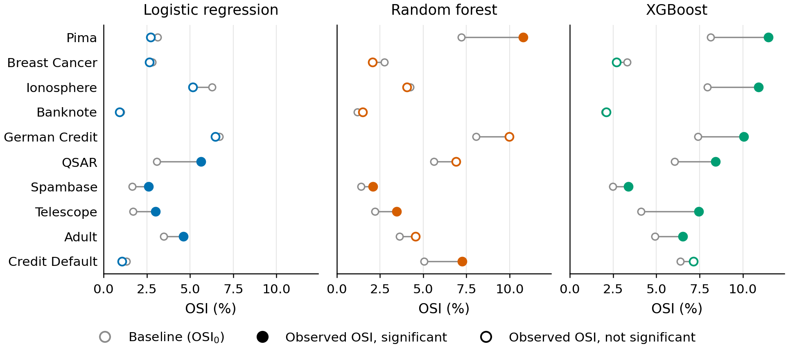
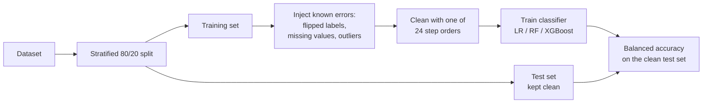
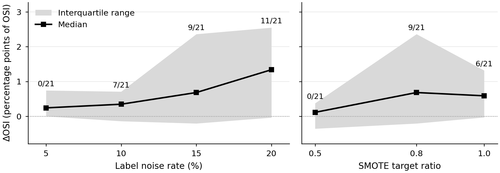
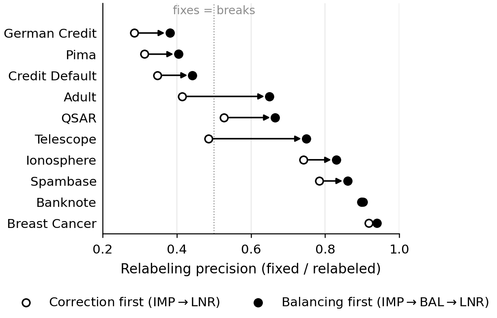
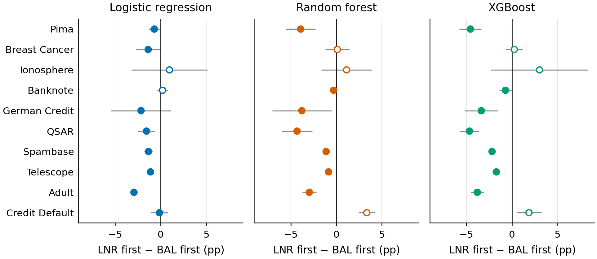
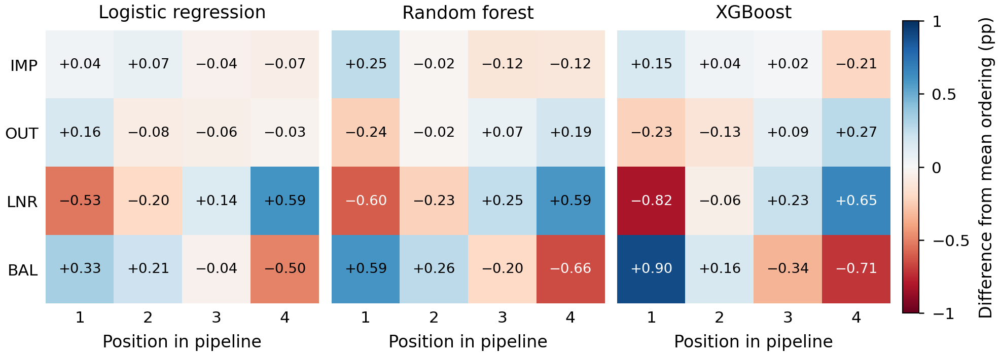

<div align="center">

# Data Cleaning Order Sensitivity

**Does the order of your data-cleaning steps change your model's accuracy, and by how much once chance is ruled out?**

[](https://www.python.org/)
[](https://scikit-learn.org/)
[](https://xgboost.ai/)
[](https://imbalanced-learn.org/)
[](#the-experiment)

</div>

---

Before a model is trained on tabular data, the data usually go through four repairs: **fill missing values, remove outliers, fix wrong labels, balance the classes**. Most pipelines apply them in whatever order is conventional. Each step changes the data the next step receives, so the order can change the final model.

Measuring this is harder than it looks. If you try 24 orders on a few random train/test splits, the best and the worst will always differ, **even when order has no effect at all**. Most comparisons report that gap as if it were real.

This project:

1. **Measures the gap correctly.** It introduces the *Order Sensitivity Index* (OSI) and a permutation test that estimates how large the gap would be by chance alone.
2. **Tests every order exhaustively.** All 24 orders of the four steps, 12 datasets, 3 classifiers and 9 experimental conditions: 41,185 runs.
3. **Finds the cause of the largest effect.** Injected errors are tracked, so every label the cleaning step changes can be checked as right or wrong.

## Key findings

| | Finding |
|---|---|
| **Chance is large** | In every dataset–classifier pair, chance alone explains **more than half** of the gap between the best and worst order. |
| **Real effects remain** | Order still matters beyond chance in **15 of 30** pairs, by **0.6 to 2.8 points** of balanced accuracy. |
| **Label noise drives it** | Significant pairs rise from **0 of 21** at 5% label noise to **11 of 21** at 20%. When label errors are spread evenly across classes, the effect disappears. |
| **The key decision** | The most consistent ordering decision is **whether to balance classes before or after correcting labels**. |
| **Why** | A label-correction model trained on imbalanced data "fixes" correct minority labels. On the Adult dataset it changed 2,451 labels, and **1,435 of them were already correct**. |
| **The fix** | Balancing the classes *inside* the correction model's own cross-validation folds raised balanced accuracy by **1.4 to 1.9 points for all three classifiers** (significant after Holm correction). |
| **Practical defaults** | An order chosen on other datasets had **37–68% lower regret** on a new dataset than a randomly chosen order. |

<p align="center">
  
  <br><sub><b>Raw OSI vs. the chance baseline.</b> Grey circles show the OSI that chance alone produces; coloured circles show the observed OSI. The gap between them is the sensitivity beyond chance, and filled circles mark pairs where it is significant.</sub>
</p>

---

## How it works

### The four steps

| Step | Code | Method (main set) | Alternative set |
|---|---|---|---|
| Missing-value imputation | `IMP` | k-nearest neighbours (k = 5) | Median |
| Outlier removal | `OUT` | Isolation Forest (5%) | Local Outlier Factor |
| Label noise correction | `LNR` | Out-of-fold random forest, relabel at confidence ≥ 0.7 | Edited nearest neighbours |
| Class balancing | `BAL` | SMOTE / SMOTENC to ratio 0.8 | Random oversampling |

### One run, step by step



Within a seed, all 24 orders start from the same split and the same injected errors. The only thing that changes is the order.

### The Order Sensitivity Index

```text
        best mean score − worst mean score
OSI  =  ----------------------------------
                best mean score
```

OSI alone is biased upward: with many orders and few seeds, the best and worst always differ. The permutation test fixes this. Within each seed it shuffles the scores between orders 10,000 times and recomputes OSI each time. That gives:

- **OSI₀**: the OSI expected when order has no effect
- **ΔOSI = OSI − OSI₀**: the sensitivity beyond chance
- **a p-value** for each dataset–classifier pair, corrected for false discovery rate

The test needs no extra model training. It reuses scores that any order comparison already produces, so it can check any pipeline comparison, not just these four steps.

---

## Results at a glance

<table>
<tr>
<td width="50%"><br><sub><b>More label noise, more order sensitivity.</b></sub></td>
<td width="50%"><br><sub><b>Balancing first makes label correction more accurate</b> on 9 of 10 datasets.</sub></td>
</tr>
<tr>
<td width="50%"><br><sub><b>Balancing before correction wins on most datasets.</b> Credit Default is the clear exception.</sub></td>
<td width="50%"><br><sub><b>Where each step belongs.</b> Balancing does best early, label correction late.</sub></td>
</tr>
</table>

---

## The experiment

| | |
|---|---|
| Datasets | 12 public binary datasets (UCI, OpenML): medical, credit, income, spam, chemistry, physics, air quality, software defects |
| Classifiers | Logistic regression, Random Forest, XGBoost (fixed hyperparameters, no tuning per pipeline) |
| Orders | All 24 orders of the four steps, plus all 41 shorter sequences |
| Seeds | 5 per condition (20 in a stability check) |
| Metric | Balanced accuracy |
| Total | **41,185 runs** across 9 conditions |

**Conditions:** main setting · natural data with no injected errors · alternative cleaning methods · label noise at 5, 10 and 20% · symmetric label noise · oversampling ratios 0.5 and 1.0 · severe class imbalance · shorter step sequences · 20 seeds.

Every data-dependent step is fitted on training data only. The test set is never cleaned, resampled or corrupted.

---

## Quick start

```bash
git clone https://github.com/idrees118/data-cleaning-order-sensitivity.git
cd data-cleaning-order-sensitivity
python -m venv .venv && source .venv/bin/activate      # Windows: .venv\Scripts\activate
pip install -r requirements.txt
```

Check that every dataset loads (this also downloads and caches the OpenML datasets):

```bash
python check_datasets.py
```

### Reproduce the results

| Step | Command | What it produces |
|---|---|---|
| 1. Run one condition | `python run_extended.py --stage main` | Per-run results in `results/main/` |
| 2. Analyse | `python analyze.py` | OSI, permutation tests, LNR-vs-BAL tests, position effects, transfer → `results/analysis/` |
| 3. Mechanism | `python diagnostics.py` | Which labels the correction step fixed or broke |
| 4. Robustness | `python robustness_r4.py` | Fold-safe correction, 20-seed stability, transfer |
| 5. End-to-end check | `python e2e_foldsafe.py` | Fold-safe correction followed by the full pipeline |
| 6. Thresholds and effect sizes | `python final_r5.py` | Correction thresholds 0.6–0.9, Hodges–Lehmann intervals |
| 7. Figures | `python figures.py` | All figures, plus 17 automatic checks against the reported numbers |

Stages for step 1: `main`, `clean`, `methods_b`, `subsets`, `high_ir`, `smote_050`, `smote_100`, `noise_05`, `noise_10`, `noise_20`, `noise_sym`, `seeds20`. Runs are checkpointed per seed, so you can stop a run and resume it later.

The summary tables behind every result are already in `results/analysis/`, so steps 2–7 work without rerunning the full experiment. The per-run results are archived on Zenodo.

---

## Repository structure

```text
├── src/
│   ├── data/loaders.py          # 12 datasets, nominal-feature handling, OpenML caching
│   ├── faults/injection.py      # label flips, missing values, outliers, with a record of each
│   ├── cleaning/methods.py      # the four steps (method set A)
│   ├── cleaning/alternatives.py # method set B and oversampling-ratio variants
│   ├── metrics/osi.py           # OSI and false-discovery-rate correction
│   └── models/train.py          # classifiers and evaluation
├── run_extended.py              # runs every pipeline for a condition
├── analyze.py                   # permutation tests and all summary tables
├── diagnostics.py               # grades label corrections against the known flips
├── robustness_r4.py             # fold-safe correction and stability checks
├── e2e_foldsafe.py              # end-to-end fold-safe comparison
├── final_r5.py                  # threshold sensitivity and effect sizes
├── figures.py                   # figures and consistency checks
├── data/raw/                    # cached copies of the datasets
├── figures/                     # all figures (PDF and PNG)
└── results/analysis/            # summary tables behind every result
```

---

## What this project demonstrates

- **Experimental design:** isolating one variable (step order) while holding the split, the errors, the seeds and the models fixed.
- **Statistics:** permutation tests, false-discovery-rate and Holm corrections, exact Wilcoxon tests, Hodges–Lehmann intervals, and avoiding selection bias in best-vs-worst comparisons.
- **Data quality engineering:** controlled fault injection with ground truth, so each cleaning decision can be audited.
- **ML engineering:** leakage-safe pipelines (cross-validation inside the cleaning step, training-only fitting), handling mixed numeric and categorical data, and class imbalance.
- **Reproducible research software:** seeded runs, checkpointing, code fingerprints, and automatic checks that the figures match the reported numbers.

---

## Versions

| Version | Description |
|---|---|
| `main` | Current code, used for all results above. |
| [`dmkd-v1`](https://github.com/idrees118/data-cleaning-order-sensitivity/tree/dmkd-v1) | Earlier release (7 datasets, 2,520 runs). It fitted a temporary imputer inside label correction before its cross-validation split; this is fixed on `main`. Kept for transparency. |

---
